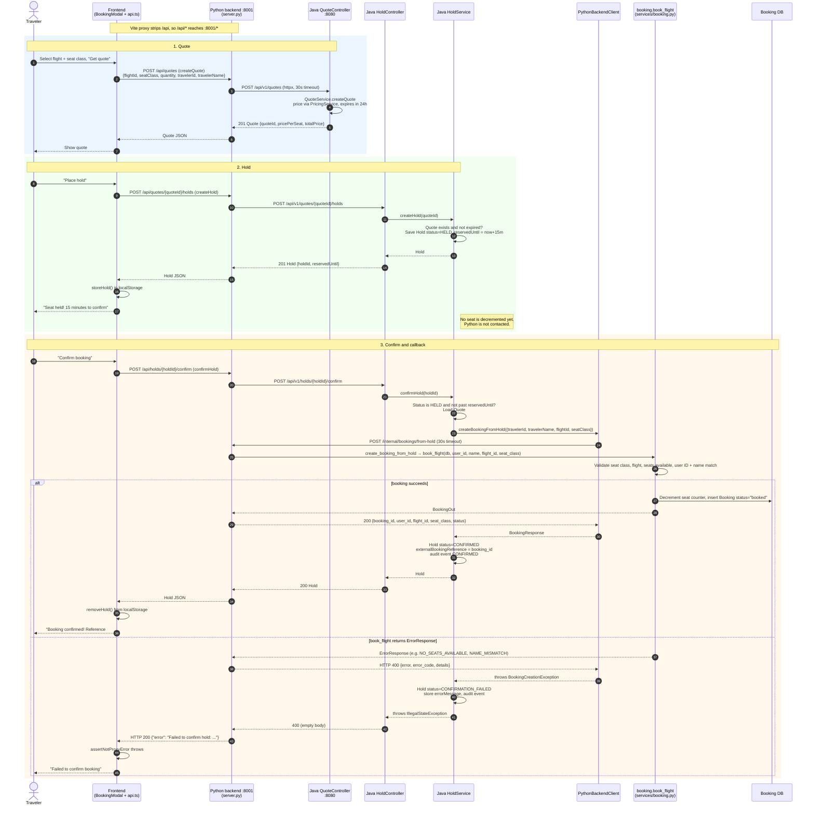

# Booking through the hold service

This sequence diagram shows a traveler requesting a quote, placing a hold, and confirming it, including the callback from the Java hold service to `/internal/bookings/from-hold` that creates the Python booking.

